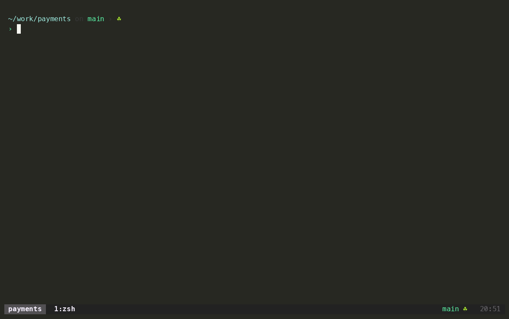
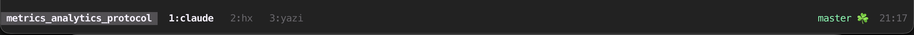

# zenide

Терминальная IDE на [tmux](https://tmux.github.io/), [Helix](https://helix-editor.com) + всё, что вам угодно.

- Удобно переключаться между бесконечным кол-вом проектов
- Удобно работать с ИИ-харнессом
- `hjkl`-friendly
- Легко кастомизировать и тестировать

[Возможности](#возможности) · [Клавиши](#мои-клавиши) · [Установка](#установка) ·
[Карта системы](docs/onboarding.md) · [Архитектура](docs/architecture.md) ·
[Грабли](docs/pitfalls.md) · [Как менять под себя](docs/extending.md)




<sup>Про запись демо см. [Terminal as an Agent Runtime](#agent-runtime)</sup>

## Что это

Набор конфигов и скриптов, который превращает терминал в модульную среду разработки.

Буквально так: ghostty, один таб на проект. Внутри таба tmux-сессия, а её окна
работают контекстами: редактор, файлы, git, поиск, агент. Есть статус бар и система навигации через клавиши.

Как это устроено внутри — одной страницей: [карта
системы](docs/onboarding.md). Что куда кладётся, за счёт чего всё это спокойно ложится
поверх конфигов, которые у тебя уже есть.

## Для кого

Думаю, должно совпасть все нижеперечисленное:

- **Кто уже живёт в терминале.** Если у тебя по отдельности стоят tmux, helix
  или vim, yazi, lazygit, ripgrep, то здесь они связаны между собой.
- **Кто любит работать с клавиатуры.** У Helix это из коробки, и та же логика во всей среде. Пальцы особо не переучиваются.
- **Кто устал от ограничений GUI.** Когда все есть, но удобной среды "под себя" не складывается. Этот репозиторий про
  обвязку, которая дает платформу для создания своей IDE "на века".
- **Кто работает с агентами в терминале.** Про это ниже отдельно, и это
  оказалось сильнее, чем я ожидал.

## Почему это появилось

Я начинал с модульного `~/.zshrc`, разложенного по разным sh-модулям. Было удобно добавлять новое, контролировать рост конфигов.
Я пользовался отдельными инструментами время: fzf, tmux, но вся профессиональная работа оставалась в vscode.
Когда накопился опыт работы с отдельными задачами в терминале, я захотел перенести в терминал всю работу и никогда не возвращаться в vscode. Так появилась идея склеить ~~велосипед~~ разные инструменты в единую среду.

Из того, что лично мне показалось удобнее прошлого опыта: популярные проекты разложены по табам ghostty с мгновенным переключением, в другие можно мгновенно переключаться через tmux. Переключения между контекстами внутри проекта (редактор / гит / что угодно) делается тоже мгновенно и полностью с клавиатуры. Любую хотелку легко добавить и сделать рабочим инструментом.

Также было желание слезть с "иглы" Cursor. Теперь TUI-агенты органично живут рядом с навигацией по файлам, коду, гиту.

Когда решил опубликовать, то свел все подходы в модульную систему, которую удобно расширять. Форкать этот репо можно и
нужно, см. [оговорки](#оговорки).

## Возможности

Всё, за чем обычно идут в полноценную IDE, здесь закрыто:

- 🔍 найти файл по имени в проекте;
- 🔎 найти текст по всему проекту, в том числе внутри PDF, Office, zip, sqlite;
- ✏️ заменить по проекту, с глобами include и exclude;
- 📦 посмотреть, что изменилось, собрать индекс, закоммитить;
- 🕰  узнать, кто и зачем написал строку, и проследить её историю сквозь
  переименования файла;
- 🗂  ходить по дереву файлов, не выходя из редактора, или открыть полноценный
  файловый менеджер (yazi);
- 🪟 держать несколько проектов открытыми и переключаться между ними;
- 🤖 держать агента рядом с редактором;
- ⚡️ выполнить разовую команду, не теряя контекст;
- 🧭 вспомнить любую клавишу сетапа.

И каждую задачу делает тул, который ей и занимается, поэтому, как правило, умеет
больше встроенной фичи: `rga` ищет внутри PDF, Office, zip и sqlite, `delta`
подсвечивает изменения посимвольно внутри строки, `lazygit` собирает коммит из
отдельных строк, а blame показывает историю одной строки сквозь переименования
файла. Небольшая скриптовая обвязка нужна, чтобы эти тулы работали вместе. Полный
список со ссылками в [из чего собрано](#из-чего-собрано).

## Работа с гитом из hx

Встал в Helix на строку, нажал `C-Space B` — открылся blame на этой строке.
Дальше всё в одном попапе, с клавиатуры:

| Хочу | Как |
|---|---|
| Узнать, кто менял строку и что написал в коммите | Уже видно при открытии |
| Посмотреть дифф | Появляется в превью при выборе строки |
| Увидеть коммит целиком, со всеми файлами | `Enter` |
| Проследить, как менялась именно эта строка | `C-l`: список коммитов с превью каждой правки |
| Из истории строки раскрыть полный коммит | `Enter` на выбранной правке |
| Почитать файл на ревизии выбранного коммита | `C-o`: откроется в Helix на нужной строке, только для чтения |
| Продолжить разбор в git-клиенте | `C-g`: lazygit с фильтром по файлу |
| Скопировать хеш коммита | `C-y` |

Файл и строка уже взяты из редактора, дифф обновляется при выборе.
Можно пройти от текущего кода до прошлых изменений, не набирая пути,
номера строк и git-команды.

Удобны переходы между lazygit и hx:
- из lazygit нажатие на `e` откроет файл в редакторе,
- и наоборот - `C Space G` откроет текущий файл редактора в lazygit.

## Мои клавиши

Префикс `C-Space`. Регистр в моем сетапе задаёт смысл: строчная переключает, заглавная
делает то же с текущим файлом редактора, или с чем-то в фокусе.

| | |
|---|---|
| `o` | фаззи-пикер файлов проекта |
| `/` | живой поиск по тексту проекта |
| `R` | заменить по проекту |
| `e` · `E` | файловый менеджер · он же на каталоге текущего файла |
| `g` · `G` | git-клиент · он же на текущем файле |
| `D` | дифф ханка под курсором |
| `B` | blame, история строки и старые версии файла |
| `Enter` | в окно Helix, а если он не запущен, то поднять его |
| `f` · `s` | переключатель проектов · дерево живых сессий |
| `Space` | попап-терминал в текущем каталоге |
| `?` | все клавиши сетапа, включая клавиши внутри попапов |

## Статусная строка

Что в статусе: cлева имя проекта, дальше окна-контексты (редактор, гит, shell-сессия, и что угодно). Справа состояние git
и часы.



 Значки для статуса гита подобраны так, чтобы читаться без легенды:

| | |
|---|---|
| `main` | ветка, в detached состоянии `:sha` |
| `🚀2` | два коммита на старте, ждут пуша |
| `↓1` | один коммит уже в remote, у тебя его ещё нет |
| `📦1` | один файл упакован в индекс, поедет следующим коммитом |
| `🎈2` | две правки держатся на ниточке: не зафиксируешь, потеряешь |
| `…3` | три файла, которых git пока не видел |
| `⛔️` | конфликт, дальше хода нет |
| `☘️` | чисто |

Статус считается для корня проекта и перерисовывается не
только по таймеру, но и при переключении окна, поэтому после коммита в
git-клиенте бар не отстаёт. При этом он не трогает `index.lock` под носом у
того же git-клиента.

## Окна и проекты

Проект это tmux-сессия. Ваши проекты задаются в `profile/projects.conf`:
`roots` это каталоги, внутри которых лежат проекты, `standalone` отдельные
репозитории, `containers` монорепо, чьи подкаталоги сами считаются проектами.
Без своего файла ищет в `~/code`, `~/projects`, `~/src`, `~/dev`. Я также
использую таб ghostty под проект, но можно переключаться и tmux-way
(C Space f).

`e`, `g`, `E`, `G`, `Enter` открывают редактор и гит как синглтоны: если еще не открывали, то откроют; если есть,
то переключат в него не создавая новое. Один helix, один yazi, один git-клиент на проект. Это оказалось удобно.
Работает так, что система находит окна по имени, а не по номеру, так что порядок не важен.

## Выбор инструментов

Ни одно имя тула не вписано в конфиги: окна и бинды берут его из
`profile/modules.conf`. Поменял строку, и в той же роли работает другой тул.

| Роль | Строка | По умолчанию |
|---|---|---|
| редактор* | `editor` | `helix` |
| git-клиент | `git_tui` | `lazygit` |
| файловый менеджер | `files` | `yazi` |
| замена по проекту | `search` | `scooter` |
| поведение с хуками | `modules` | у меня включены оба модуля раскладки |

\* С редактором сложнее остальных: ему нужен адаптер из четырёх операций (открыть
файл, спросить что в фокусе, перечитать, перейти в окно), и написан пока
только для helix. Остальные роли это просто имя команды. Переход на текущий
файл в git-клиенте сделан под `lazygit`.

## Из чего собрано

Своего кода здесь мало, почти всё делают готовые тулы. Ценность в том, что они
уже выбраны, связаны между собой и настроены: темы сведены к одной палитре,
keymap yazi отдаёт файл в работающий Helix, lazygit и scooter открывают файлы
там же, delta подключён и в git, и внутри git-TUI.

Ядро, `brew bundle --file=Brewfile`, 14 формул:

| Потребность | Тул |
|---|---|
| окна, попапы, хуки | [tmux](https://tmux.github.io/) (нужен ≥ 3.3) |
| терминал | [ghostty](https://ghostty.org/) |
| редактор | [helix](https://helix-editor.com) |
| файловый менеджер | [yazi](https://yazi-rs.github.io) |
| git | [lazygit](https://github.com/jesseduffield/lazygit/) |
| все пикеры и попапы | [fzf](https://junegunn.github.io/fzf/) |
| список файлов проекта | [fd](https://github.com/sharkdp/fd) |
| поиск по тексту | [ripgrep](https://github.com/BurntSushi/ripgrep), [ripgrep-all](https://github.com/phiresky/ripgrep-all) (внутри PDF, Office, zip, sqlite) |
| замена по проекту | [scooter](https://github.com/thomasschafer/scooter) |
| подсветка диффов | [git-delta](https://dandavison.github.io/delta/) |
| подсветка кода в blame | [bat](https://github.com/sharkdp/bat) |
| прыжок по каталогам | [zoxide](https://github.com/ajeetdsouza/zoxide) |
| переключение раскладки | [macism](https://github.com/laishulu/macism) (нужен только модулю клавиатуры) |

Остальное в `Brewfile.full` и ставится по желанию:

| Потребность | Тул |
|---|---|
| другие git-клиенты | [gitui](https://github.com/gitui-org/gitui), [tig](https://jonas.github.io/tig/) |
| дифф с учётом синтаксиса | [difftastic](https://difftastic.wilfred.me.uk/) |
| `ls` с деревом и git-статусом | [eza](https://eza.rocks) |
| JSON и YAML с фолдингом | [jless](https://jless.io/) |
| markdown-превью в браузере | [vivify](https://github.com/jannis-baum/Vivify) |
| архивы в файловом менеджере | [sevenzip](https://7-zip.org) |
| маунт хостов по ssh из yazi | [fuse-t](https://www.fuse-t.org/), [fuse-t-sshfs](https://github.com/macos-fuse-t/sshfs) |
| HTTP-клиент в терминале | [slumber](https://slumber.lucaspickering.me) |
| линтеры и форматтеры | [shellcheck](https://www.shellcheck.net/), [shfmt](https://github.com/mvdan/sh), [clang-format](https://clang.llvm.org/docs/ClangFormat.html) |
| markdown LSP | [marksman](https://github.com/artempyanykh/marksman) |
| рантаймы и LSP | [mise](https://mise.jdx.dev) — node/pnpm/bun, LSP-стек, prettier, ruff, ty одним файлом; [uv](https://docs.astral.sh/uv/) для venv, [rustup](https://rustup.rs) для rust |

Там же моё личное, нужное только мне:
[neovim](https://neovim.io/) как запасной редактор и
[wireshark](https://www.wireshark.org) ради `tshark` для разбора pcap.

Конфиги лежат в `ide/` и симлинкуются в `~/.config`: `tmux`, `helix`, `yazi`,
`lazygit`, `ghostty`, `scooter`, `git`, `gitui`, `tig`, `vivify`, `prettier`,
`slumber`.

LSP под веб-стек, python и rust ставит личный `bootstrap.sh`, а не
`install.sh`: набор там мой и под мои проекты.

## Установка

### Сначала попробовать, ничего не устанавливая

```bash
git clone https://github.com/pikulev/zenide.git ~/zenide
cd ~/zenide && ./try
```

`./try` поднимает весь сетап в песочнице: подменяет `HOME` и `XDG_*` внутри клона и
запускает tmux на отдельном сокете. Твои `~/.config/*`, `~/.tmux.conf` и
работающие сессии не задеты — личные startup-файлы шелла и git identity не подхватываются. Выход —
`exit`. Песочница сама печатает, чем отличается от реальной установки, чтобы
решение принималось по честной картинке.

### Установка

```bash
brew bundle --file=Brewfile        # ядро: 14 формул, этого хватит
brew bundle --file=Brewfile.full   # по желанию: остальное из таблиц выше

./install.sh                       # показывает план и выходит
./install.sh --apply               # применяет
```

**Без аргументов `install.sh` ничего не делает** — сначала показывает, что
случится с твоими файлами. Ставится только ядро: четыре симлинка. Конфиги
helix, yazi и git-клиента остаются твоими, пока не попросишь явно.

| Хочу | Флаг |
|---|---|
| взять и конфиги соседей | `--with helix,yazi` · `--with all` (слои — [`ide/LAYERS`](ide/LAYERS)) |
| копии вместо симлинков | `--copy` |
| вернуть всё как было | `--uninstall` |

Свой конфиг ломать не обязательно: в `ide/<тул>/CONTRACT*` лежит тот минимум,
который достаточно врезать в свой файл. Что из этого уже на месте, а что
сломано — скажет `zenide doctor`.

Подробно: [установка и `bootstrap.sh`](docs/install.md) · [что происходит с
конфигами и почему так](docs/onboarding.md).

### Установка с агентом

Или ещё проще — запусти так:

```bash
git clone https://github.com/pikulev/zenide.git ~/zenide
cd ~/zenide && claude
```

Промпт, который я бы дал:

```
Поставь zenide на эту машину, мои конфиги при этом не потеряй.

1. Прочитай AGENTS.md и docs/onboarding.md.
2. Посмотри, что у меня уже есть в ~/.config (tmux, helix, yazi, git-TUI) и
   чем это раскатано: обычные каталоги, симлинки, stow/chezmoi.
3. Предложи состав: что брать целиком через --with, а куда достаточно
   врезать ide/<тул>/CONTRACT* в мой существующий конфиг.
4. Покажи `./install.sh --with … ` (без --apply) и объясни каждую строку
   плана, особенно «УЕДЕТ в бэкап». Ничего не применяй, пока я не скажу «да».
5. После установки прогони `zenide doctor` и разберись с разделом
   «затенение», если он красный.
6. Помоги заполнить profile/*.local — git identity и корни моих проектов.
```

## Как менять под себя

Вкус и личное живут в `profile/`: тема, корни проектов, свои бинды, выбор
инструментов. Механика в `libexec/zenide/`, личных данных в ней нет. Правило
на каждую правку одно: это механика или вкус.

Свой инструмент прикручивается в `profile/`, ядро при этом не трогается, и в
шпаргалку он попадает сам. Подробно: [docs/extending.md](docs/extending.md).

## Проверка

```bash
./tests/run.sh    # изолированный сокет tmux, живая сессия не трогается
zenide doctor
```

Тесты проверяют то, что глазами не видно: что команды доезжают до редактора
целиком, что нет гонки с хуком перечитывания, что контекст читается при
сплитах, инварианты шпаргалки и подмену инструментов.

<a name="agent-runtime"></a>

## 💎 Terminal as an Agent Runtime

Это выяснилось уже после перехода и оказалось сильным преимуществом при кастомизации.

Весь интерфейс тут текст в псевдотерминале. Любое окно читается через
`tmux capture-pane`, любое нажатие шлётся через `tmux send-keys`. Значит агент
работает со средой теми же руками, что и я: жмёт клавиши, смотрит на экран,
видит результат. Не генерирует патч вслепую, а сам проверяет и тестирует.

Запись в шапке сделана именно так: Claude поднял тестовый проект в
изолированной tmux-сессии, проиграл сценарий и собрал GIF. Руками не нажато
ничего. Скрипт лежит в [docs/demo/record.sh](docs/demo/record.sh), можно
использовать как шпаргалку для тестирования интерфейса.


## Оговорки

- **Это seed, а не дистрибутив.** Он задуман, чтобы его форкнули и переделали
  под себя, дальше он твой. Расти он будет вместе с моей
  машиной, поэтому иногда что-то поменяется не обратно совместимо; такое я
  записываю в [CHANGELOG](CHANGELOG.md). Слои внутри сделаны так, что
  `git pull upstream` обычно проходит чисто, пока правки живут в `profile/`.
  Вопросы и issue всегда пожалуйста, просто учти, что отвечаю я в свободное
  время.
- **macOS.** Ядро и `ide/tmux` переносимы на Linux. Привязаны к macOS только
  `bootstrap.sh` и выдача прав в
  [TCC](https://support.apple.com/guide/mac-help/control-access-to-files-folders-mac-mchld5a35146/mac)
  (система разрешений macOS, та самая, что спрашивает про доступ к файлам и
  папкам). Права нужны, только если монтируешь хосты по ssh из файлового
  менеджера.
- **Фулскрин и одна галочка в macOS.** Сам я почти всегда держу терминал в
  нативном фулскрине: одно окно на весь экран, без заголовков и чужих панелей,
  всё переключение внутри tmux. У такого окна свой Space, и на macOS Tahoe
  переход в него по `Cmd+Tab` из коробки может не работать: в меню-баре имя
  приложения меняется, а на экране остаётся предыдущее. У меня это вылечила
  галочка **System Settings → Desktop & Dock → Mission Control → «When
  switching to an application, switch to a Space with open windows for the
  application»**.
- **Комментарии и UI по-русски.**
- **Вендоренные плагины.** `ide/yazi/plugins/{git,sshfs}.yazi` взяты со стороны
  и идут со своими лицензиями.

## Лицензия

MIT
