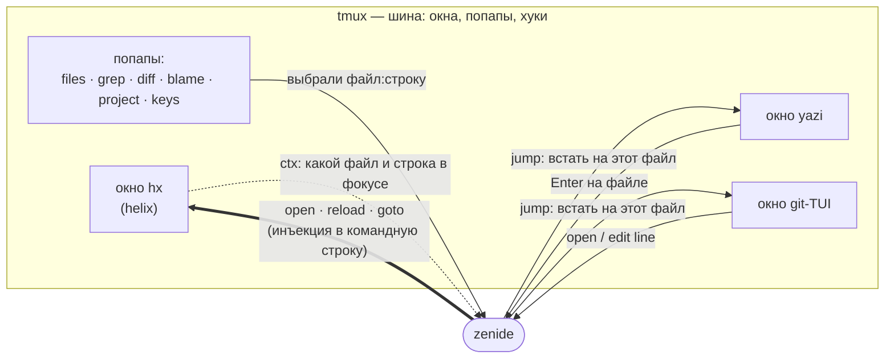

# Архитектура

## Тезис

> **У Helix нет remote-API. Поэтому tmux работает шиной IPC, а не просто
> мультиплексором.**

Из этого следует весь остальной дизайн. Нельзя послать работающему редактору
«открой файл X на строке Y» — ни по сокету, ни по RPC. Единственный доступный
канал — командная строка самого редактора, то есть пейн, в котором он живёт.
Значит кто-то должен уметь: найти пейн с редактором, разбудить его, набрать
команду так, чтобы она не рассыпалась, и не подраться при этом с хуками.

Это «кто-то» и есть `zenide`. Редактор от него ничего не знает и не требует
патчей — он остаётся обычным `hx` в обычном пейне.



Стрелка от `hx` обратно к `zenide` — вторая половина идеи и то, что отличает
этот сетап от «просто открыть файл в редакторе». Мост двусторонний: мы не
только отдаём файл редактору, но и **спрашиваем у него, что сейчас в фокусе**.
Именно это даёт контекстные прыжки: blame того файла, что под курсором, дифф
того ханка, yazi на том каталоге.

## Модель

- **Сессия = проект.** Одна tmux-сессия на репозиторий; `#{session_path}` —
  корень проекта, и именно он (а не cwd пейна) считается контекстом: cwd
  пейна бывает подпапкой или домом. `project` переиспользует сессию по
  абсолютному пути; совпадение имён каталогов разрешает суффиксом `-2`, `-3`.
- **Окна = контексты.** `hx`, `yazi`, git-TUI, `search`, что угодно ещё. Окна
  ищутся **по имени** (`-t '=yazi'`) или по процессу
  (`pane_current_command == hx`), никогда по номеру: номера плывут из-за
  `renumber-windows`.
- **Попапы = одноразовые действия.** Выбрал файл — попап исчез, состояние не
  хранится. Это фича, а не упрощение.
- **Регистр клавиши = смысл.** Строчная — просто переключиться, состояние окна
  не трогая (`e`, `g`, `R`). Заглавная — прыжок С КОНТЕКСТОМ текущего файла
  (`E`, `G`, `D`, `B`). Два этих действия нельзя смешивать в одной клавише:
  именно разделение делает заглавные предсказуемыми.

## Как говорить с редактором

Редактор — слот. Контракт — **четыре операции**, и только они:

| Операция | Что делает |
|---|---|
| `open <файл> [строка]` | открыть в работающем редакторе и переключиться на его окно |
| `ctx` | вернуть файл и строку сфокусированного буфера |
| `reload` | перечитать буфер с диска |
| `goto` | прыгнуть в окно редактора («домой»), поднять, если его нет |

Реализация для helix — `libexec/zenide/editor/helix/`. Другой редактор — это
другой каталог с теми же четырьмя файлами. Второго адаптера в репозитории нет
намеренно: непроверенный адаптер хуже отсутствующего.

### Протокол инъекции

Внутри `open` — четыре неочевидных решения, и каждое куплено отладкой:

1. **`Escape`, затем пауза.** Без паузы ESC склеивается со следующим символом,
   и helix читает это как `Alt-<char>` — команда печатается текстом в буфер.
2. **Тело команды — bracketed paste, не `send-keys`.** `send-keys` доставляет
   байты как одиночные нажатия, и команда «бежит» по экрану посимвольно.
   `paste-buffer -p` отдаёт её одним paste-событием — один кадр.
3. **Порядок `open → reload → goto`.** `:open` лишь ПЕРЕКЛЮЧАЕТ на уже
   открытый буфер, не перечитывая диск: без `:reload` увидишь старое
   содержимое после `git checkout` или работы форматтера. А `goto` обязан быть
   последним — `reload` сбрасывает курсор.
4. **Флаг `@hx_skip_reload`.** Хук `session-window-changed` сам впрыскивает
   `:reload-all` при входе в окно. Если `open` только что переключил окно, две
   инъекции подрались бы за командную строку. `open` ставит window-опцию
   только перед переходом в ДРУГОЕ окно, хук её снимает и молчит.
   Открытие из попапа над hx не оставляет флаг на следующий переход.
   **Любой новый впрыскиватель обязан соблюдать этот протокол.**

Общий транспорт — `libexec/zenide/lib/helix.sh`: уникальный paste-буфер на
процесс и `tmux wait-for` для последовательной доставки в один пейн.
Ожидание блокировки ограничено пятью секундами; при ошибке команда
завершается, чужая блокировка не снимается. Это сериализует отправителей
zenide, но не блокирует клавиатуру пользователя.

Пути в `:open` передаются одним literal-аргументом Helix, а при запуске
нового процесса — отдельным argv tmux, без сборки shell-команды. Пробелы,
кавычки, `$()` и `%sh{}` в имени остаются данными. Пути с переводом строки
не поддерживаются двухстрочным протоколом `ctx`; `open` их отклоняет.

Безопасность `reload` держится на `auto-save.focus-lost` в конфиге helix: при
уходе из окна правки уже на диске, поэтому перечитывание ничего не теряет.
Это **требование к соседу**, его проверяет `zenide doctor`.

### Как читается состояние

`ctx` передаёт `%{buffer_name}` и `%{cursor_line}` в quoted heredoc со
случайным разделителем, пишет во временный каталог и ждёт полный ответ.
Shell не интерпретирует содержимое heredoc; `%u{a}` создаёт переводы строк
после разбора промпта Helix. При таймауте или неверном ответе `ctx` возвращает
ненулевой код. Почему не парсинг статусбара: при сплитах статуслайнов несколько, и
определить по ним, какой из них в фокусе, нельзя. Экспансии helix знают
именно сфокусированный сплит. Парсинг статусбара остался фолбэком.

## Контракты

Это то, что обязано оставаться стабильным: ломающее изменение здесь требует
строки в `CHANGELOG.md`.

1. **Загрузка.** `ide/tmux/tmux.conf` в конце: `source-file -q` темы и
   `local.conf`, затем `zenide modules load`. `-q` значит «нет файла — не
   ошибка»: ядро поднимается на чистой машине.
2. **Данные.** Ядро не знает путей. `project` читает `profile/projects.conf`;
   дефолт — автодетект `~/code`, `~/projects`, `~/src`, `~/dev`, иначе `$HOME`.
3. **Инструменты.** Окна ищутся по имени, редактор — по
   `pane_current_command`. Что чем занято — слоты в `profile/modules.conf`.
4. **Расширение.** `zenide keys` сканирует `libexec/` и `profile/`: личный
   скрипт со строкой `# keys:` попадает в справку `C-Space ?` сам, ядро
   править не нужно.
5. **Редактор.** Четыре операции выше.
6. **Модуль.** `modules/<имя>/`: `init.sh` (обязателен, вешает хуки сам),
   `check.sh` (опционален, для `doctor`), `README.md`. Реестра нет — ядро не
   знает о модулях ничего.

## Слои

```
libexec/zenide/   МЕХАНИКА — подкоманды, мост, справка. Личных данных нет
ide/<tool>/       КОМПОЗИЦИЯ — конфиги тулов, симлинкуются в ~/.config
modules/<name>/   ПОВЕДЕНИЕ, выключаемое — хуки, генерация биндов
profile/          ВКУС — тема, корни проектов, свои бинды, слоты
shell/            ZSH — к работе IDE не нужен, живёт отдельно
```

Правило отнесения, одно и на каждую правку: **это механика или вкус?** Вкус,
личное, пути, идентичность → `profile/`. Механика, соглашение, протокол →
`libexec/` или `ide/`. Не получается решить → `profile/`: ядро должно
оставаться маленьким, ошибка в эту сторону дешевле.

## Opt-in: три механизма, ни одного флага

Фича-флагов нет. То, что выглядит как флаги, — три разные сущности:

| Что | Это на самом деле | Механизм |
|---|---|---|
| кириллица, форс-латиница | **поведение** с хуками | модуль в `modules`-списке |
| `lazygit` / `gitui` / `tig` | **выбор** из слота | переменная в профиле |
| `rga`, `bat`, `delta`, `macism` | **возможность среды** | автодетект, `command -v` |
| тема, корни проектов, бинды | **вкус и данные** | файл-оверрайд в `profile/` |

Правило третьей строки: **если шелл может ответить на вопрос сам, не спрашивай
пользователя.** Флаг «у меня есть bat» — второй источник правды, который
протухнет в день установки bat.

Следствие: **в `tmux.conf` нет условий.** Бинд висит всегда, а отсутствие
зависимости обрабатывает сам скрипт — сообщением и подсказкой, что поставить.
`%if`/`%endif` в конфиге не появляются вовсе.

Почему не флаги: флаг заставляет ядро знать о каждой опциональной вещи по
имени (`if [ "$cyrillic" = 1 ]` где-то внутри). Это противоположность тезису.
Модуль-как-каталог означает, что ядро не знает ничего, а модуль регистрирует
себя сам — разница между «написано, что модульно» и «видно, что модульно».

Все три механизма сходятся в `zenide doctor` — он и есть ответ на вопрос
«почему у меня `C-Space /` не работает».

### Диагностика: текст, JSON и Textual

`doctor` без аргументов остаётся shell-командой без Python-зависимостей.
`doctor --json` выполняет те же проверки и отдаёт один JSON-документ:
`schema_version: 1`, `root`, `profile`, `checks`, `exit_code`. Каждая запись
содержит стабильный `id`, `group`, `group_title`, `status` (`ok`, `warn`,
`error`, `info`), `title`, `detail`, `hint`, `file`. Пустые инструкция и путь
передаются пустыми строками. `hint` — инструкция для человека, не команда
для автоматического исполнения. Код 1 означает найденную ошибку и всё ещё
сопровождается валидным отчётом; код 2 — неверный вызов.

`doctor --ui` — опциональная витрина на Textual (`libexec/zenide/ui/`). Она
вызывает `doctor --json` через установленный диспетчер в
`${XDG_CONFIG_HOME:-$HOME/.config}/zenide/bin/zenide`, не разбирает текстовый
отчёт и не дублирует проверки. Python запускается напрямую из отдельной
виртуальной среды, поэтому её `bin/` не подменяет PATH проверяемого процесса.
Проверки идут в фоне; через 30 секунд, при повторном запуске или закрытии
экрана группа процессов диагностики завершается. Незавершённая проверка
показывается как неизвестное состояние, старые результаты при ошибке
убираются.

Первая версия интерфейса только читает: поиск по проверкам, фильтр проблем,
инструкция, повторная проверка и открытие связанного файла. В tmux интерфейс
сначала закрывается, затем вызывает `zenide open`; вне tmux временно отдаёт
терминал Helix и повторяет проверки после его выхода. Формы записи профиля
и установка пакетов пока отсутствуют. `ok` относится к наблюдению в `detail`:
например, наличие строки в конфиге не доказывает состояние уже запущенного
редактора. Проверки `check.sh` модулей не заменяют проверку системных прав.

Палитра и оформление живут в `profile/doctor.tcss.local.example`; личный
`doctor.tcss.local` активного профиля имеет приоритет. Окружение и команды
установки — в [onboarding.md](onboarding.md) и [install.md](install.md).

## Справка, которую нельзя рассинхронить

`zenide keys` (`C-Space ?`) своих данных не хранит вообще:

- твои бинды — из `tmux list-keys -N`, заметка в формате `"группа: описание"`;
  группа должна быть в `ORDER` внутри `keys`, и она же служит признаком «это
  мой бинд, а не дефолт tmux»;
- клавиши ВНУТРИ попапов — из строки `legend='…'` или `# keys: …` в самом
  скрипте попапа;
- метка попапа — из `list-keys`: ищем, какая prefix-клавиша зовёт
  `zenide <имя>`;
- дефолты tmux — остальные заметки, отдельной секцией снизу.

Второго места для этих данных нет, поэтому рассинхрон невозможен по
конструкции. Цена: **каждому** своему бинду нужен `-N "группа: описание"` —
без заметки клавиша выпадает из справки МОЛЧА, потому что `list-keys -N`
печатает только бинды с заметкой. Это проверяется тестом (`tests/t-config.sh`).

## Что проверяется автоматически

Проверяется всё, что ломается молча, включая попапы с fzf: напрямую из
неинтерактивного процесса fzf не запустить, но внутри tmux-пейна у него есть
pty, и `capture-pane` читает его экран.

- инъекция в helix: файл и строка действительно те (по статусбару);
- в буфер не падает текст команды (режим отказа при склейке ESC);
- протокол `@hx_skip_reload` в обе стороны;
- `ctx` при сплитах;
- инварианты справки: у всех биндов есть `-N`, все группы есть в `ORDER`;
- заменяемость слота: `git_tui=gitui|tig` действительно меняет окно.

`./tests/run.sh` — всё на изолированном сокете `tmux -L zenide-test`,
с временным HOME/XDG и профилем из текущего checkout. Установка zenide в
домашний каталог не требуется. Ошибка старта сервера немедленно завершает
тест, чтобы мост не мог обратиться к сокету живой сессии.
